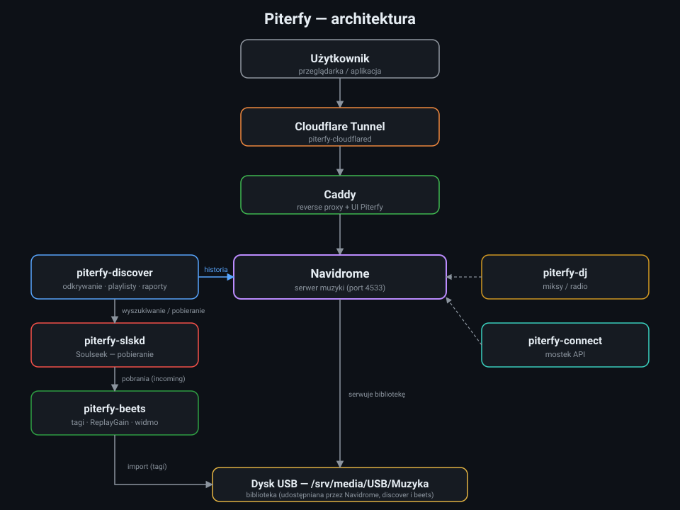
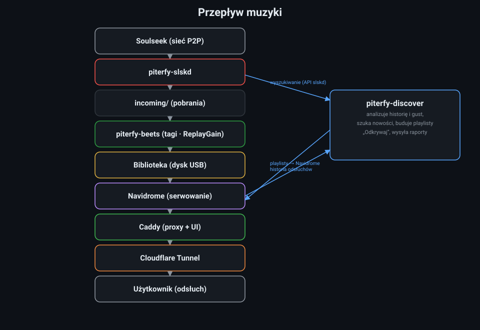
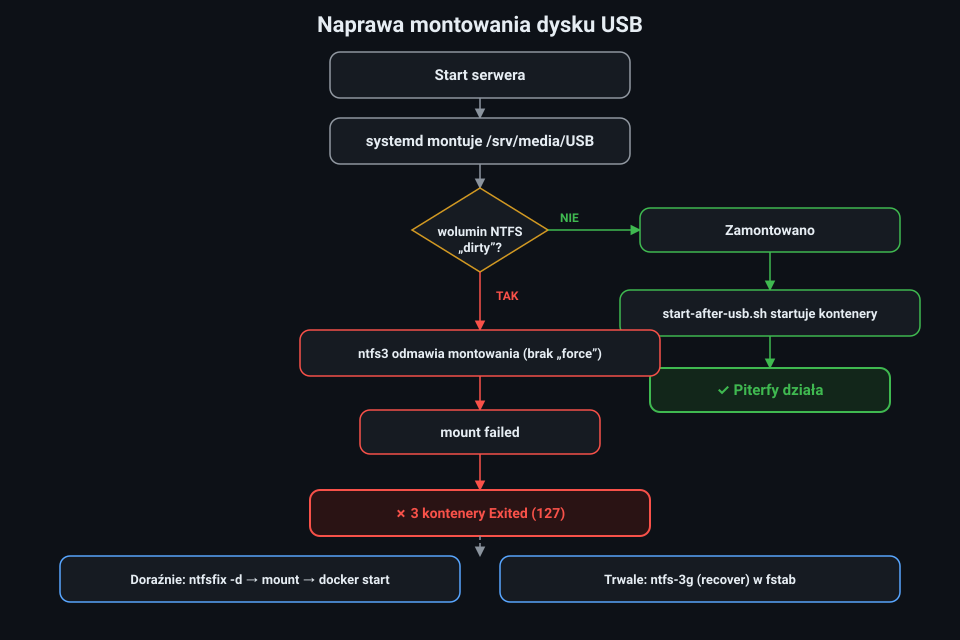

# Piterfy — dokumentacja

> Samodzielnie hostowana platforma muzyczna: strumieniowanie własnej biblioteki,
> codzienne odkrywanie nowej muzyki przez Soulseek, automatyczne tagowanie i miksy.

To repozytorium zawiera **dokumentację** projektu Piterfy — bez kodu i bez danych
uwierzytelniających. Diagramy SVG opisują architekturę kontenerów, przepływ muzyki
oraz naprawę montowania dysku USB z biblioteką.

## Architektura



### Usługi (kontenery)

| Kontener | Rola |
|---|---|
| `piterfy-navidrome` | serwer muzyki (Navidrome), udostępnia bibliotekę i API |
| `piterfy-caddy` | reverse proxy + wstrzykiwanie własnego UI (Piterfy) |
| `piterfy-cloudflared` | tunel Cloudflare (dostęp z zewnątrz) |
| `piterfy-slskd` | klient Soulseek — wyszukiwanie i pobieranie utworów |
| `piterfy-discover` | codzienne odkrywanie muzyki, playlisty „Odkrywaj”, raporty, podcasty |
| `piterfy-beets` | import i tagowanie (beets), ReplayGain, analiza widma |
| `piterfy-dj` | miksy / radio |
| `piterfy-connect` | mostek API |

## Przepływ muzyki



1. `discover` i `dj` wyszukują utwory w Soulseek przez `slskd`.
2. `slskd` zapisuje pobrania do katalogu `incoming/`.
3. `beets` przenosi je do biblioteki, poprawia tagi, liczy ReplayGain i widmo.
4. `navidrome` serwuje bibliotekę przez `caddy` i tunel Cloudflare do użytkownika.

## Dysk USB z biblioteką

Biblioteka muzyczna leży na zewnętrznym dysku USB, montowanym w `/srv/media/USB`
(katalog muzyki: `/srv/media/USB/Muzyka`). Trzy kontenery — `piterfy-navidrome`,
`piterfy-discover` i `piterfy-beets` — montują ten katalog z opcją
`create_host_path: false`. Celowo **nie** startują, gdy dysku nie ma, żeby Navidrome
nie oznaczył całej biblioteki jako brakującej.

### Incydent: „volume is dirty” i kontenery Exited (127)

Po nieczystym restarcie (zanik zasilania) sterownik jądra `ntfs3` odmówił montowania
woluminu NTFS oznaczonego jako „dirty”:

```
ntfs3(sda2): It is recommended to use chkdsk.
ntfs3(sda2): volume is dirty and "force" flag is not set!
```

W efekcie dysk nie był zamontowany, a trzy kontenery wymagające
`/srv/media/USB/Muzyka` kończyły działanie z `Exited (127)` (błąd OCI runtime:
brak ścieżki bind-mount).



**Naprawa doraźna:**

```bash
sudo ntfsfix -d /dev/disk/by-uuid/881AF3301AF319C0
sudo systemctl start srv-media-USB.mount
docker start piterfy-navidrome piterfy-discover piterfy-beets
```

**Rozwiązanie trwałe** — zamiana sterownika na `ntfs-3g`, który domyślnie wykonuje
`recover` i sam montuje „brudny” wolumin:

```
UUID=881AF3301AF319C0 /srv/media/USB ntfs-3g rw,nosuid,nodev,noexec,nofail,x-systemd.device-timeout=15s,uid=1000,gid=1000,umask=022 0 0
```

Po każdym restarcie skrypt `start-after-usb.sh` (crontab `@reboot`) czeka na dysk i
dopiero wtedy startuje kontenery muzyczne.

## Repozytorium

Dokumentacja jest celowo oddzielona od kodu i sekretów (`.env`, tokeny, baza
plików). Diagramy są pisane ręcznie w SVG, bez zewnętrznych bibliotek.
